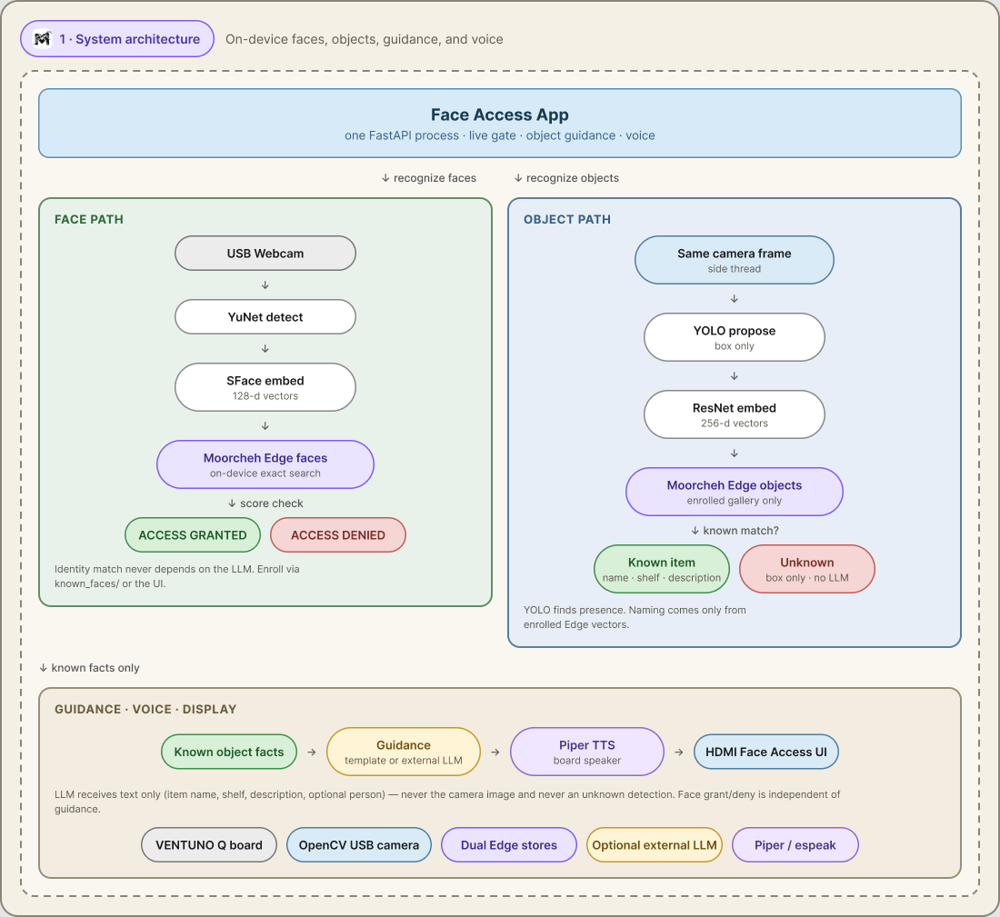
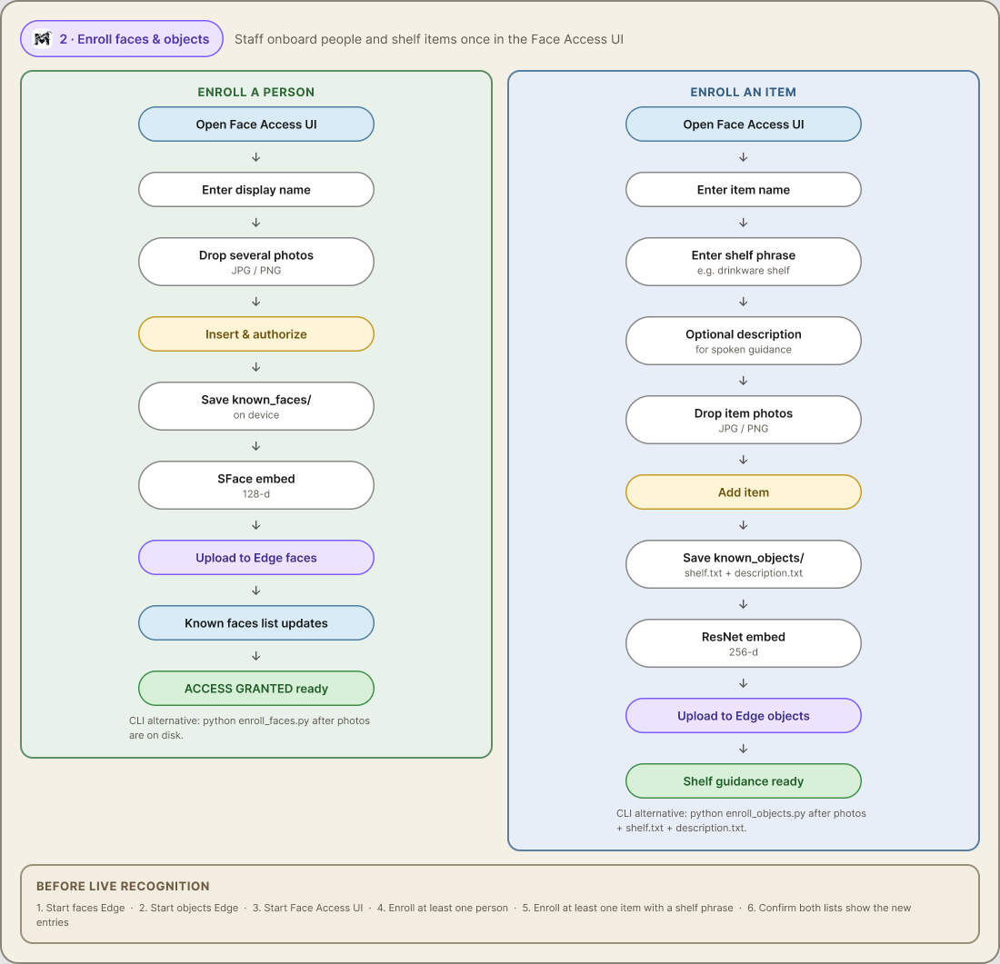
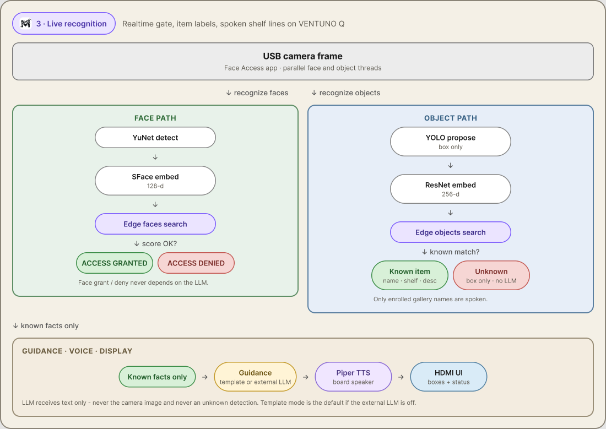

# ShelfIn with Moorcheh Edge - Access + Shelf Guidance on Ventuno Q

Turn **Ventuno Q** into a privacy-first **ShelfIn** appliance: USB camera in, on-device face and object matching, spoken shelf lines, browser UI out - no cloud face APIs.

## Overview

**ShelfIn** runs on **Ventuno Q** with **Moorcheh Edge** as the on-device match layer.

A USB webcam watches the scene. The app does two jobs in parallel:

1. **Faces** - OpenCV **YuNet** finds faces, **SFace** builds 128-d embeddings, **Moorcheh Edge faces** searches the enrolled gallery → **ACCESS GRANTED** or **ACCESS DENIED**.
2. **Objects** - **YOLO** proposes boxes, **ResNet** builds 256-d embeddings, **Moorcheh Edge objects** searches enrolled items. Only a **known** match gets a name, shelf, and description. Unknown boxes stay visual-only.

When an item is known, the app builds a short spoken line:

- **Template mode** (default) - fixed sentence from name + shelf
- **LLM mode** (optional) - an **external** chat LLM (Ollama or OpenAI-compatible) rewrites the same facts already in memory into one natural sentence

Speech uses **standalone Piper** when installed under `~/piper/`, with **espeak** as fallback. The browser never plays audio; the board speaker does.

Everything that matters for matching stays on the board: models, vectors, and decisions. Spoken guidance does **not** use Moorcheh `/answer` or a third Edge RAG store. The optional LLM receives **text facts only** (already matched name / shelf / description) - never the camera image, and never an unknown detection.

Powered by **Moorcheh** - PyPI `moorcheh-edge`, Docker `moorcheh/moorcheh-edge`, docs at [docs.moorcheh.ai/on-edge](https://docs.moorcheh.ai/on-edge).

**Repo:** [github.com/moorcheh-ai/moorcheh-face-access](https://github.com/moorcheh-ai/moorcheh-face-access)

**Demo video:** _Add link when the demo cut is ready._

---

## Why Moorcheh

Moorcheh Edge is built for **on-device vector search**. ShelfIn keeps two Edge stores on the same board:

| Store | Port | Container | Vectors |
|-------|------|-----------|---------|
| Faces | **8083** | `moorcheh-edge-faces` | SFace 128-d |
| Objects | **8081** | `moorcheh-edge-objects` | ResNet→256-d |

On edge hardware this matters:

- Fast similarity search as galleries grow
- Stable scores you can threshold for GRANT / DENY and known / unknown items
- No cloud round-trip for identity or product match
- Same Edge runtime pattern used across Moorcheh on-device projects

YuNet, SFace, YOLO, and ResNet stay in the Python app. Edge is the match layer. Spoken lines use a template or an external LLM; Piper / espeak is the voice layer.

---

## Why edge access + shelf guidance?

- **Privacy** - embeddings and decisions stay on the device
- **Reliability** - matching does not depend on internet uptime
- **Latency** - detect, embed, and search run on the board
- **Control** - you decide thresholds and who / what is enrolled
- **Retail clarity** - known items speak a shelf line; unknowns are never invented by the LLM
- **Simple ops** - USB-C power, USB camera, browser UI after one-time setup

---

## System architecture

End-to-end path from camera to UI and speaker:



Diagrams (Figma): [VENTUNO Face Access - System Architecture](https://www.figma.com/design/4ZReJYcUDZaEkj22gzJerR/VENTUNO-Face-Access-%E2%80%94-System-Architecture)

### Plain-language flow

1. The USB camera sends frames into ShelfIn.
2. The **face path** asks: “Do we know this person?” → grant or deny on the screen.
3. The **object path** asks: “Is this an enrolled item?” → if yes, use its name, shelf, and description.
4. If the item is known, build one short sentence (template or external LLM).
5. Piper / espeak speaks that sentence on the board speaker.
6. The browser shows the live stream, boxes, and status (Wi-Fi or HDMI).

Unknown objects get a red **Unknown** box only. They are **not** sent to the LLM.

### Technical flow (faces)

1. Frame (cadence every **3** frames, scale **0.35**)
2. YuNet detect → SFace embed (**128-d**)
3. Search Moorcheh Edge faces
4. Score ≥ `FACE_MATCH_THRESHOLD` (default **0.28**) → **ACCESS GRANTED** + name

### Technical flow (objects)

1. Same camera frame pushed to a side thread (every **3** frames)
2. YOLO proposes boxes (not names)
3. ResNet embed (**256-d**) on each crop
4. Search Moorcheh Edge objects (top **3**, margin **0.03**)
5. Score ≥ `OBJECT_MATCH_THRESHOLD` (default **0.38**) → known name + shelf + description
6. Else → **Unknown** (draw only)

### Technical flow (guidance + voice)

1. Only **known** object facts (and optional person name) enter guidance
2. `GUIDANCE_MODE=template` → fixed sentence from those facts
3. `GUIDANCE_MODE=llm` → external chat LLM with the facts in the prompt; fallback to template if the LLM is down
4. Standalone Piper (or espeak) speaks the line on the board speaker

---

## What runs on Ventuno Q

| Piece | Role |
|-------|------|
| **Moorcheh Edge faces** (Docker) | Face vector store + search |
| **Moorcheh Edge objects** (Docker) | Object vector store + search |
| **ShelfIn app** (FastAPI) | Live gate UI, enroll APIs, MJPEG stream |
| **YuNet / SFace** | Face detect + 128-d embed |
| **YOLO / ResNet** | Object box propose (LiteRT `.tflite` preferred, Torch fallback) + 256-d embed |
| **External LLM** (optional) | Spoken-line rewrite from in-memory facts |
| **Piper / espeak** | On-device TTS to the speaker |
| **USB webcam** | Live frames (`CAMERA_BACKEND=opencv`, index `0`) |
| **Browser / HDMI** | GRANT / DENY, item boxes, onboarding |

Day-to-day: start faces Edge, start objects Edge, start the UI. Camera, thresholds, audio runtime, and Piper paths are set by `start.sh` defaults.

---

## Enroll faces and objects

Staff enroll people and shelf items once. After that, live recognition can grant access and speak shelf lines.



### Enroll a person (UI)

1. Open the ShelfIn UI
2. Under **Onboard a person**, enter a display name
3. Drop or choose several photos (JPG / PNG)
4. Click **Insert & authorize**
5. Vectors upload to **Moorcheh Edge faces**

### Enroll an item (UI)

1. Under **Add an item**, enter name, shelf phrase, and optional description
2. Drop or choose item photos
3. Click **Add item**
4. Vectors upload to **Moorcheh Edge objects**

### Bulk enroll (backend scripts)

For larger galleries, skip the UI and run scripts:

```bash
# Faces: photos already under known_faces/<Name>/
python enroll_faces.py

# Objects: photos + shelf.txt + description.txt under known_objects/<Item>/
python enroll_objects.py
```

Face and object images stay on the device (`known_faces/` and `known_objects/` are gitignored).

### Enroll checklist

1. Faces Edge up (`start_faces_edge.sh`)
2. Objects Edge up (`start_objects_edge.sh`)
3. ShelfIn UI running (`start.sh`) - or run the CLI enroll scripts with Edge up
4. At least one person and one item enrolled
5. Confirm both lists before relying on live recognition

---

## Live recognition



1. USB camera frame arrives
2. **Face path** - YuNet → SFace → Edge faces → **ACCESS GRANTED** or **ACCESS DENIED**
3. **Object path** - YOLO → ResNet → Edge objects → known item or **Unknown**
4. If known → guidance sentence → Piper / espeak on the speaker
5. UI shows boxes, scores, and gate status

Face grant / deny never depends on the LLM. Unknown objects never go to the LLM.

Defaults (set by `start.sh` / `config.py` - no exports required):

| Knob | Default |
|------|---------|
| Camera backend | `opencv` |
| Camera index | `0` |
| Face match | `0.28` |
| Object match | `0.38` |
| Object fallback | `0.55` |
| Object margin | `0.03` |
| Guidance | `template` |
| Piper | auto if `~/piper/piper/...` exists |

---

## Features

**Entrance / visitor**

- Live camera gate with ACCESS GRANTED / DENIED
- Identity label and similarity score
- Known item boxes + shelf line
- Unknown object boxes without inventing names
- Browser UI over Wi-Fi or HDMI

**Staff**

- Multi-photo person onboarding
- Item upload with name, shelf, description
- Bulk CLI enroll for larger sets

**Developers**

- Dual Moorcheh Edge stores
- Optional external LLM guidance + Piper / espeak TTS
- Scripts: `start_faces_edge.sh`, `start_objects_edge.sh`, `start.sh`, `enroll_faces.py`, `enroll_objects.py`

---

## Hardware requirements

- **Ventuno Q** - Ubuntu / ARM Linux, Docker capable
- **USB webcam** - OpenCV index `0` by default
- **USB sound adapter + speaker** - Piper / espeak
- **USB-C power**
- **Network** - first-time clone / models; UI at `http://<board-ip>:8501/`
- Optional: HDMI for local development; USB-C to PC for first SSH (Wi-Fi SSH works too)

---

## Software stack

| Layer | Choice |
|-------|--------|
| Face detect | OpenCV YuNet (ONNX) |
| Face embed | OpenCV SFace, 128-d (ONNX) |
| Object propose | Ultralytics YOLOv8n |
| Object embed | ResNet18 → 256-d |
| Vector DB + search | Moorcheh Edge (Docker) × 2 |
| Spoken rewrite (optional) | External chat LLM (Ollama / OpenAI-compatible) |
| TTS | Standalone Piper or espeak |
| App / UI | Python FastAPI + static web UI |
| Camera | OpenCV VideoCapture (V4L2) |

---

## Getting started

### One-time setup

1. Clone [github.com/moorcheh-ai/moorcheh-face-access](https://github.com/moorcheh-ai/moorcheh-face-access)
2. Install Docker; add your user to the `docker` group
3. Create venv and install deps
4. Download face models; place `yolov8n.pt` in the project root
5. Optional: install Piper under `~/piper/piper/` (otherwise espeak)
6. Follow **[README.md](./README.md)** for exact commands

```bash
cd ~
git clone https://github.com/moorcheh-ai/moorcheh-face-access.git
cd moorcheh-face-access
python3 -m venv faceenv && source faceenv/bin/activate
pip install -U pip
pip install -r requirements-retail.txt
bash ./scripts/download_models.sh
# place yolov8n.pt in project root
```

### Every boot (day-to-day)

Camera, thresholds, `XDG_RUNTIME_DIR`, and Piper autodetection are already defaults in `start.sh`.

```bash
cd ~/moorcheh-face-access
source faceenv/bin/activate
bash ./start_faces_edge.sh
bash ./start_objects_edge.sh
bash ./start.sh
```

Open **http://127.0.0.1:8501/** on the board, or **http://\<board-ip\>:8501/** from another machine on the same Wi-Fi.

Enroll at least one person and one item (UI or bulk scripts) before the live demo.

### Optional overrides

Only if you need them:

```bash
# export CAMERA_INDEX=2
# export GUIDANCE_MODE=llm
# export PIPER_BIN=~/piper/piper/piper
# export PIPER_MODEL=~/piper/piper/en_US-lessac-medium.onnx
```

Edge docs: [docs.moorcheh.ai/on-edge](https://docs.moorcheh.ai/on-edge)

---

## Ports

| Port | Service |
|------|---------|
| **8083** | Moorcheh Edge faces |
| **8081** | Moorcheh Edge objects |
| **8501** | ShelfIn web UI |
| **11434** | Optional external Ollama (only if `GUIDANCE_MODE=llm`) |

---

## Use cases

- Door / lobby face access on Ventuno Q
- Retail or warehouse shelf guidance for enrolled products
- Privacy-first demos without cloud face APIs
- Edge AI proof-of-concept before a fixed install

---

## Links

- ShelfIn / Face Access - https://github.com/moorcheh-ai/moorcheh-face-access
- Moorcheh Edge - https://github.com/moorcheh-ai/moorcheh-edge
- Documentation - https://docs.moorcheh.ai/on-edge/
- PyPI - https://pypi.org/project/moorcheh-edge/
- Docker Hub - https://hub.docker.com/r/moorcheh/moorcheh-edge
- Architecture diagrams (Figma) - https://www.figma.com/design/4ZReJYcUDZaEkj22gzJerR/VENTUNO-Face-Access-%E2%80%94-System-Architecture
- Moorcheh - https://moorcheh.ai
- Demo video - _placeholder_
